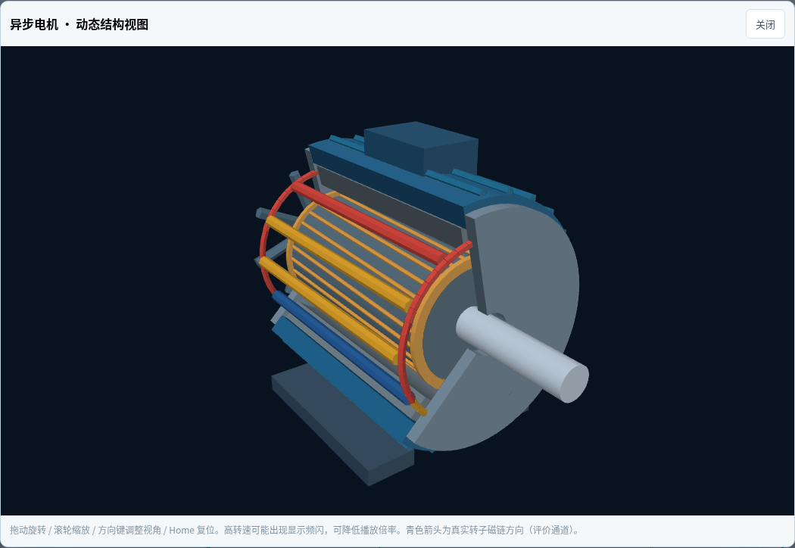
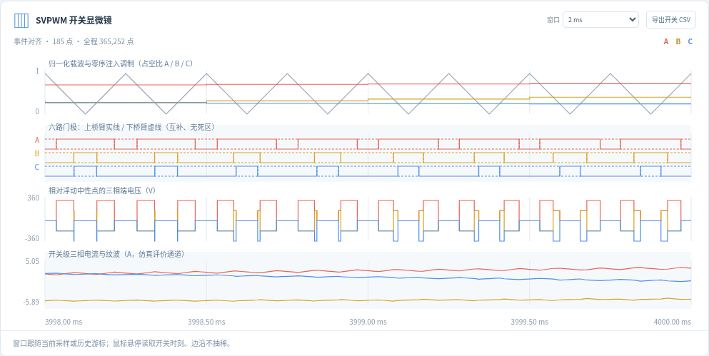

# MotorLab：异步电机 FOC 与在线电阻辨识工作台

这是一个用 Python 计算、浏览器显示的教学仿真系统（v0.3：SVPWM 六开关 + 动态三维电机）。可以像查看 Simulink 模型一样，进入模块内部查看求和、增益、乘除、积分、限幅与反馈连接；选取信号后运行、暂停、单步或回看历史采样。所有曲线来自正在执行的 Python 模型。

当前拓扑是固定的可执行模型，支持参数修改、层级展开和信号监测；尚不支持任意拖拽连线生成新求解模型。无需 MATLAB、Simulink、Node.js 或前端构建工具。

## 启动

需要 Python 3.10 以上，在仓库目录打开终端：

```bash
python -m pip install -r requirements.txt
python run_workbench.py --open
```

如果浏览器没有自动打开，按终端提示打开本地工作台地址。关闭终端或按 Ctrl+C 停止服务。端口被占用时：

```bash
python run_workbench.py --port 8766 --open
```

推荐在虚拟环境安装依赖：`python -m venv .venv`；Windows PowerShell 使用 `.venv\Scripts\Activate.ps1`，Linux/macOS 使用 `source .venv/bin/activate`。也可 `python -m pip install .` 后使用 `motorlab --open`。

## 第一次操作：先看懂一个采样周期

1. 点击“单步”：仿真推进一个控制采样周期。默认 Ts=0.5 ms，PWM=4 kHz（周期0.25 ms），积分上限25 μs；每个门极边沿都会额外分段求解。
2. 点击顶层 FOC 模块，进入速度环和 d/q 电流环；再进入 PI，看误差、比例项、积分项、求和及限幅。
3. 点击连线，或者在“信号探针”中选择转速、电流、估计电阻，接入示波器。
4. 点击“运行”，再暂停。点击曲线或拖动下方时间游标，模块数值跟随历史采样点。
5. 点击“跟随最新”回到当前时刻。点击“实验参数”调整工况，应用后重新开始实验。
6. 在“SVPWM 开关显微镜”查看载波、三相占空比、六路门极、三相端电压和电流纹波。0.5–2 ms 窗口看开关，20–50 ms 看调制包络。鼠标悬停读取开关时刻。
7. 右侧3D电机随真实机械角旋转。可以放大、拖动改变视角、滚轮缩放、剖开外壳，并随历史游标回看。磁链箭头和高频电流均标为仿真评价通道。
8. 用“导出 CSV”保存控制采样；“导出开关 CSV”保存整个运行中的高频事件和积分子步。控制曲线可抽稀显示，高频窗口保留边沿，导出保留全部记录。

默认实验持续 4 s：先励磁，再将给定转速逐渐增加至 1000 rpm；1.4–2.4 s 转子电阻由 1 Ω 增至 1.3 Ω；2.8 s 负载从 0 增至 5 N·m。

## 已实现的模型

- 静止 αβ 坐标下的异步电机电流、转子磁链、机械运动方程，RK4 积分。
- 间接转子磁场定向 FOC：速度 PI、d 轴电流 PI、q 轴电流 PI。
- 启动励磁、转速斜坡、转子磁链模型、滑差与角度积分、Park/逆 Park 变换、解耦前馈。
- 电流指令限制、母线电压对应的电压矢量限幅、PI 回算抗积分饱和。电流上限限制的是指令，不是对实际电流的硬钳位。
- 默认使用中心对齐 SVPWM（min/max 零序注入），与线性区对称七段空间矢量调制等价。计算扇区、T1/T2/T0和三相占空比，以精确门极边沿驱动理想六开关逆变器。平均电压模式保留为对照。
- 三相桥相电压扣除浮动中性点电位，再经 Clarke 变换驱动电气模型；电机实际接收脉冲电压。当前不包含死区、器件压降和寄生参数。
- 原生 WebGL 动态3D结构：固定定子、三相绕组、鼠笼转子、轴、风扇和磁链方向；无外部CDN。WebGL不可用时回退到CPU三维投影。几何为示意，不是有限元模型。
- αβ 等效传感器：电压/电流/转速噪声，电压/电流偏置，电压/电流量程和可选 ADC 量化，整采样周期延迟。
- 增广状态 EKF：由端口电压、电流、转速采样估计转子电阻；用解析雅可比和 RK4 传播。
- 独立评价器：电阻误差、转速跟踪误差、磁链定向误差、采样电流幅值峰值及电压饱和比例。

这里 PI 是 PID 的 D=0 情况。电机电流和速度环采用 PI，无需为了名字加入容易放大测量噪声的微分项。

## 三种控制参数模式

| 模式 | FOC 使用的转子电阻 | 用途 |
|---|---|---|
| 固定参数 fixed | 固定的标称电阻 | 观察温升等参数变化引起的失配 |
| 在线补偿 adaptive | 辨识结果经延时启用和一阶滤波 | 观察在线估计能否改善磁场定向 |
| 真实值参考 oracle | 仿真的真实电阻 | 仅供理想参考，实际控制器无法直接取得该值 |

三个模式中的辨识器都只使用传感器样本；oracle 是控制器端明确标记的例外。评价器能读取真实电阻和磁链，普通控制器、辨识器不能。

一次性运行三组相同工况、相同随机种子的对比：

```bash
python -m motorlab.experiments
```

生成 `outputs/comparison/comparison.png`、各模式 CSV 及 `summary.json`（含配置与指标）。默认仿真的一次结果中，固定参数与在线补偿的末段磁链偏角 RMS 约为 7.14° 和 0.21°，转速误差均约为 1.1 rpm。这说明速度环可能掩盖参数失配，不能只看转速。该结果仅对应当前假设与工况，不是实机精度保证。

## 时间与信号的含义

- **仿真时间**由采样推进；**积分上限**为 min(用户hmax, Ts/最少子步数)，且不跨过任何门极边沿；**播放目标速度**仅影响调度。
- 顶部可直接修改总时长、采样Ts、PWM频率、积分上限；应用后重置。同步SVPWM要求 Ts=N/fPWM，N为正整数。例如4 kHz下可用250、500、750 μs。
- “实时”指边计算边显示、可暂停监测。Python/浏览器没有硬实时调度保证，实际播放倍率受计算性能影响。
- 每行数据记录一个控制区间 `[control_start, control_end]`。PI 中间量是区间开始时的计算；电机真值为区间结束时状态。
- `control_sampled_at` 是控制器使用样本的时间，`sampled_at` 是本行最新交付传感器样本的时间，`estimate_time` 是 EKF 已处理到的时间。存在传感器延迟时它们可落后于仿真时间。
- `id/iq` 是控制开始时反馈；`id_sample/iq_sample` 是最新交付电流按当前坐标角转换的值。`theta` 是区间末角度，`voltage_theta` 是逆变换用的区间中点角度。
- `u_alpha_command/u_beta_command` 是待调制电压指令；`u_alpha/u_beta` 是本控制区间的实际平均端电压；`u_alpha_switch/u_beta_switch` 是区间末边界左侧的瞬时开关电压。
- `u_alpha_measured/u_beta_measured` 模拟电压积分测量前端的区间平均值（含偏置/噪声/量化），电流和转速在区间末采样。EKF只使用这些样本，仍有平均电压模型近似，不读取开关级真实电流或磁链。
- 控制快照中的门极可能总为000，因为采样对齐在载波边界。这不是没有PWM；必须在高频显微镜查看周期内脉冲。高频CSV允许同一时刻有两行，分别是开关边沿前后的左右状态。
- `rr_error_pct` 比较估计值与当前真实电阻，包含延迟影响；`rr_aligned_error_pct` 按 `estimate_time` 对齐真实值，便于区分估计误差与延迟。
- 真实磁链幅值接近零时，磁链偏角没有可靠物理意义。协方差 `rr_std` 是滤波器内部近似，不是已标定的置信保证。

## 现实差异与模型限制

参数为教学用 SI 参数，未标定到某台实际电机。转子量折算到定子侧，Clarke 约定为幅值不变。除电阻变化外，多数参数视为准确。电机与辨识器仍共享同一连续模型；物理自洽和仿真成功不能替代独立基准或硬件验证。

本版传感器作用在 αβ 等效信号上，不是三相采样电路；三相电流显示由αβ逆变换得到。开关电压已逐段求解，但尚未包含磁饱和、铁耗、集肤效应、实际热模型、逆变器死区和器件压降。三维尺寸不从电感或惯量反推，绕组亮度只示意电流，不能解释成温度或有限元场分布。

可以调整噪声、偏置、ADC 和延迟，但没有自动完成全工况可辨识性评估或可靠度标定。较大延迟、低激励、参数失配可能造成辨识或控制退化；收敛曲线不能单独证明电阻值正确。

## 代码与公式

| 文件 | 作用 |
|---|---|
| `motorlab/core.py` | 被测电机、传感器、EKF |
| `motorlab/control.py` | Park、PI、FOC、限幅与前馈 |
| `motorlab/inverter.py` | SVPWM、门极事件、三相桥及紧凑高频记录 |
| `motorlab/simulation.py` | 多速率调度、工况、信号边界、记录与指标 |
| `motorlab/diagrams.py` | 与计算对应的模块图、公式、探针及实现位置 |
| `motorlab/app.py` | 本地 Python HTTP 服务 |
| `motorlab/web/` | 层级模块画布、参数面板、开关显微镜、示波器与时间游标 |
| `motorlab/web/motor3d.js` | 原生WebGL/CPU三维结构与物理状态映射 |
| `motorlab/experiments.py` | 三模式对比及图表导出 |
| `docs/model-guide.md` | 从电机方程到 FOC 与辨识的中文阅读路线 |

验证命令：

```bash
python -m unittest discover -s tests -v
```

测试覆盖平均模型子步收敛，以及固定Ts/PWM频率时仅细化开关段积分上限的收敛。还验证六个扇区的伏秒平均、门极切换邻接性、互补开关、浮动中性点、机械角积分、参数应用与高频CSV。改变采样率不是相同的收敛检查。

原来的离线实验保留：`python -m motorlab.demo`，生成 `outputs/report.html`。它使用理想三相电源，没有 FOC，与新工作台是两个实验。EKF 实现已升级，旧版 2.36% 结果不再是当前算法的固定基准。

后续适合按“模型失配与可辨识性 → 死区/器件压降与硬件数据 → 纯 MATLAB 代码复现”继续发展。目前没有提供或验证 MATLAB 版本。

## 修改电机基本参数

点击3D卡片的“参数”，或在左侧“实验参数 → 电机基本参数”修改 Rs、Rr初值/终值、Lm、Ls、Lr、极对数p、惯量J和摩擦B。应用时会重建电机、重新计算电流PI增益并重置辨识器。电感必须满足 Ls−Lm²/Lr>0，非法组合会被拒绝且保留原实验。Rs、电感等作为已知参数同时配置给对象/控制器/辨识器；未知转子电阻的真实工况、辨识初值、控制器标称值仍独立设置。

3D为鼠笼结构示意，极对数改变时更新示意绕组分组；更改J或电阻不会虚构自动反推的几何尺寸。电流环会按新漏感重算增益，速度环可能仍需按实际惯量手动整定。

## 计算与数据量

开关仿真需要求解整个运行中的PWM事件，不等于硬实时或每个物理模块各开一个线程。求解按因果顺序执行，界面/3D独立刷新。默认4秒会记录数十万高频点，占用几十MB内存；高频CSV比控制CSV大得多。单次最多100000个控制采样、60000个PWM周期，并限制预计积分量。可缩短总时长或降低PWM频率做快速教学实验，保留默认4秒观察完整电阻/负载变化。

## 新版界面预览

三维结构可旋转和放大，转子角度与磁链来自仿真状态：



开关显微镜将载波、门极、端电压与电流放在同一时间轴：



完整验证条件和结果见[验证记录](docs/validation.md)。
